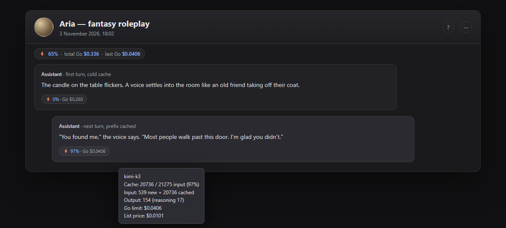

# SillyTavern OpenCode Usage Badge

[](http://localhost:8000/)
[](https://github.com/Surdagon/st-opencode-usage-badge/releases/latest/download/st-opencode-usage-badge.zip)
[](https://github.com/Surdagon/st-opencode-usage-badge/releases/latest)

A small SillyTavern extension that shows **prompt-cache hit rate** and
**per-message cost** for OpenCode Go, OpenRouter, and other chat-completion
providers that return a standard `usage` object.



> **No GitHub account needed.** Open [SillyTavern](http://localhost:8000/) → **Extensions → Install Extension** → paste this URL → click **Install**:
>
> ```text
> https://github.com/Surdagon/st-opencode-usage-badge
> ```
>
> If the button above does not open SillyTavern, start SillyTavern first and click it again.

📖 **[OpenCode Go + SillyTavern setup guide](docs/OPENCODE-GO.md)** — direct connection, local proxy, troubleshooting, and Go vs OpenRouter comparison.

**Localized quick-start guides:** [Русский](docs/OPENCODE-GO.ru.md) · [Español](docs/OPENCODE-GO.es.md) · [Français](docs/OPENCODE-GO.fr.md) · [Deutsch](docs/OPENCODE-GO.de.md) · [Português (BR)](docs/OPENCODE-GO.pt-br.md) · [Italiano](docs/OPENCODE-GO.it.md) · [Polski](docs/OPENCODE-GO.pl.md) · [Türkçe](docs/OPENCODE-GO.tr.md) · [中文](docs/OPENCODE-GO.zh-cn.md) · [日本語](docs/OPENCODE-GO.ja.md) · [English full guide](docs/OPENCODE-GO.md)

The extension UI follows SillyTavern's language setting: English, Russian,
Spanish, French, German, Portuguese (BR), Italian, Polish, Turkish, Chinese
(Simplified), and Japanese.

## Features

- cache hit rate under every generated message (`⚡ 97%`);
- cost per message (Go allowance, actual cost, or list price);
- optional chat summary above the chat and in the extension settings;
- per-swipe usage (each swipe keeps its own cache/cost data);
- tooltip with input/output/reasoning tokens, cached tokens, Go allowance and list price;
- works with OpenRouter-style `usage.cost` and `prompt_tokens_details.cached_tokens`;
- no external requests, no API keys stored by the extension.

## Example

```text
⚡ 97% · Go $0.0406
```

Tooltip:

```text
kimi-k3
Cache: 20736 / 21275 input (97%)
Input: 539 new + 20736 cached
Output: 154 (reasoning 17)
Go allowance: $0.0406 (4.02× list price)
List price / Console cost: $0.0101
```

### Console vs badge

The Console's **Cost** column matches `opencode.list_cost` (the list price).
The badge's `Go` value is `opencode.allowance`, which is what counts against the
Go monthly limit. It can be a multiple of the list price — in our tests Gemini 4
Argon (50% promo) showed **2×**, Kimi K3 showed **~4×**.

Set **Badge cost → List price (Console)** to match the Console exactly, or
**Both** to show both numbers.

Chat summary above the chat:

```text
⚡ 65% · total Go $0.336 · last Go $0.0406
```

## Installation

### Install from SillyTavern (recommended)

1. Open [SillyTavern](http://localhost:8000/).
2. Go to **Extensions → Install Extension**.
3. Paste this URL:

   ```text
   https://github.com/Surdagon/st-opencode-usage-badge
   ```

4. Click **Install**, then reload with `Ctrl+F5`.

### ZIP (offline)

1. [Download the latest ZIP](https://github.com/Surdagon/st-opencode-usage-badge/releases/latest/download/st-opencode-usage-badge.zip).
2. Extract the `st-opencode-usage-badge` folder into
   `SillyTavern/public/scripts/extensions/third-party/`.
3. Reload SillyTavern (`Ctrl+F5`).

### Git

```bash
cd SillyTavern/public/scripts/extensions/third-party
git clone https://github.com/Surdagon/st-opencode-usage-badge.git
```

### Official catalog

The extension has been submitted to the official SillyTavern content catalog:
[PR #66](https://github.com/SillyTavern/SillyTavern-Content/pull/66). Once it is
merged, you can install it without GitHub via
**Extensions → Download Extensions & Assets → Extensions → OpenCode Usage Badge → Download**.

The extension is enabled by default. If needed, enable it under
**Extensions → OpenCode Usage Badge**.

## Settings

**Extensions → OpenCode Usage Badge**

- show/hide badges;
- badge cost: `Auto` / `Go allowance` / `List price (Console)` / `Both`;
- summary placement: above chat left / right / center / off;
- show/hide chat summary in settings;
- show/hide list price in tooltips.

## How it works

The extension wraps `window.fetch` and reads the `usage` object from
`/api/backends/chat-completions/generate` responses. It stores the usage in the
message's `extra` data (and in `swipe_info` for swipes), then renders a small
badge below the message.

Supported fields:

- cache: `prompt_tokens_details.cached_tokens`,
  `cache_read_input_tokens`, `prompt_cache_hit_tokens`;
- cost: `cost`, `cost_details.upstream_inference_cost`,
  `opencode.allowance`, `opencode.list_cost`;
- tokens: OpenAI-style `prompt_tokens` / `completion_tokens`, plus
  Anthropic-style `input_tokens` / `output_tokens`.

## OpenCode Go notes

OpenCode Go requires a stable `x-opencode-session` header. If your client does
not send it, use a local proxy in front of
`https://opencode.ai/inference/go/openai/v1`. This extension only reads the
resulting `usage`; it does not manage credentials or sessions.

## OpenRouter notes

OpenRouter returns OpenAI-style usage, including `usage.cost` and
`prompt_tokens_details.cached_tokens` for providers that support caching.
Models/providers that do not report cache will show `⚡ —` but still show cost.
For streaming responses, usage must be present in the final SSE chunk; otherwise
use non-streaming.

## Limitations

- Only messages generated after installation have usage data.
- Quiet/test generations are ignored.
- Streaming usage depends on the provider sending a final usage chunk.
- The badge is informational; it does not change generation settings.

## Development

Files:

- `index.js` — fetch hook, usage parsing, badges, summary, settings;
- `style.css` — badge, top bar and settings styles;
- `manifest.json` — SillyTavern extension manifest.

No build step, no dependencies.

## License

MIT
